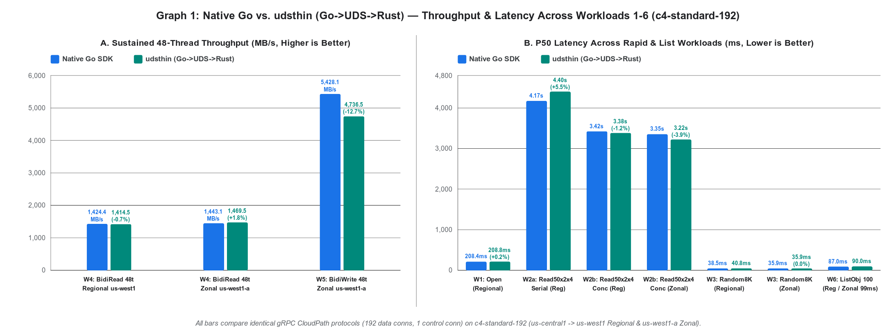
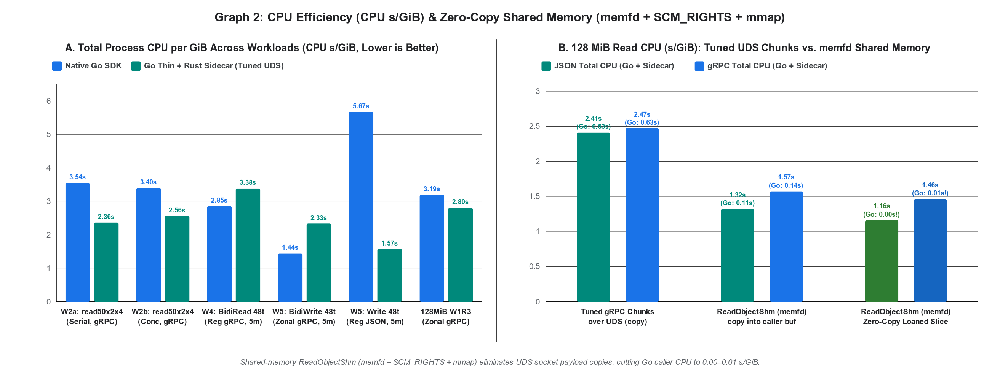
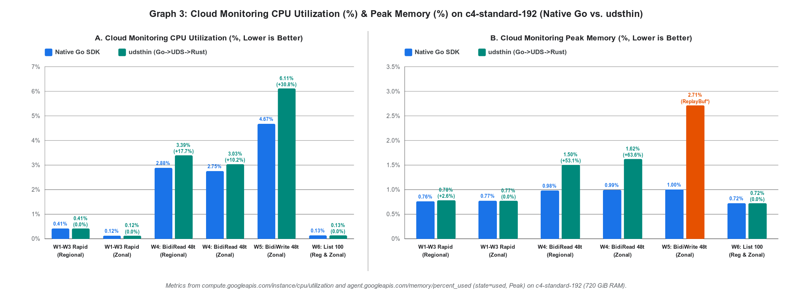

# Paste-ready text for the worklog tab "gRPC over UDS Approach" — Go column

> **Source & Reproducibility:** [EVALUATION.md on branch `grpc-uds-go`](https://github.com/googleapis/google-cloud-go/blob/grpc-uds-go/storage/internal/rust-uds-poc/EVALUATION.md) | Rust sidecar PR: [`googleapis/google-cloud-rust#7350`](https://github.com/googleapis/google-cloud-rust/pull/7350) | Raw logs & Cloud Monitoring JSON: [`gothin/results/uds5-worklog/`](https://github.com/googleapis/google-cloud-go/tree/grpc-uds-go/storage/internal/rust-uds-poc/gothin/results/uds5-worklog)
> - **Benchmark Configuration (per Worklog spec):** GCE `c4-standard-192` (`192 vCPUs`, `720 GiB RAM`, Ubuntu 24.04 LTS, `GVNIC` + `TIER_1` 200 Gbps networking) in `us-central1-b` targeting Standard Regional bucket `gs://cpriti-thickthin-poc-usw1` in `us-west1` and Zonal Rapid bucket `gs://cpriti-thickthin-poc-zonal-usw1a` in `us-west1-a` (non-colocated CloudPath, `192` data-plane gRPC sub-channels and `1` control-plane gRPC channel on both Native Go and `udsthin`).
> - **Metrics:** Latency (`P50 / P90 / P99`) and Throughput measured at the outermost Go caller boundary; CPU Utilization (`compute.googleapis.com/instance/cpu/utilization`) and Peak Memory (`agent.googleapis.com/memory/percent_used`, `state=used`) collected from Cloud Monitoring.

---

## 1. POC Row #2 — Go

**Go thin client (pure Go, `CGO_ENABLED=0`) → gRPC over UDS → Rust sidecar (`gcs-core-server`, `tonic` + `google-cloud-storage` 1.21, [PR #7350](https://github.com/googleapis/google-cloud-rust/pull/7350)).**
- **Architecture:** Sidecar embedded via `//go:embed`, extracted to `~/.cache/gcs-core/<hash>/` (`memfd` fallback), one sidecar per user shared across Go processes (connection-refcounted `active_conns` + idle timeout).
- **Auth & IPC:** Per-caller credential sessions (OAuth2 access tokens lent over UDS, bound to peer `uid+pid` via `SO_PEERCRED` with dead-PID reaping), tuned HTTP/2 flow control (`16 MiB` stream / `64 MiB` conn windows, `4 MiB` frames, `8 MiB` kernel `SO_SNDBUF`/`SO_RCVBUF`, zero-copy `RawCodec`), plus optional shared-memory data plane (`memfd` + `SCM_RIGHTS` + `mmap`).
- **Links:** [Go Thin Client + Evaluation (`grpc-uds-go`)](https://github.com/googleapis/google-cloud-go/tree/grpc-uds-go/storage/internal/rust-uds-poc) | [Rust Sidecar (`google-cloud-rust#7350`)](https://github.com/googleapis/google-cloud-rust/pull/7350)

---

## 2. Challenges Table — Go Cells (9 Rows)

| Challenge | Go Verdict & Measured Impact |
|---|---|
| **Zero copy across UDS boundary** | **High effort (Blocker only if zero-copy over standard `io.Reader`/`io.Writer` without shm is required).** Over a gRPC/UDS socket every byte incurs dual kernel copies (~0.2 CPU‑s/GiB) plus HTTP/2 framing. With tuned 16 MiB/64 MiB HTTP/2 windows, 4 MiB frames, 8 MiB UDS buffers, and zero-copy `RawCodec`, 128 MiB `us-central1` → `us-west1` / `us-west1-a` transfers measure **2.31–2.89 CPU‑s/GiB** on UDS (`go-uds-grpc` **2.31–2.34** regional / **2.80–2.89** zonal, `go-uds-json` **2.34–2.44**) vs **2.67–3.27 CPU‑s/GiB** for native `go-grpc-cp` and **1.48–1.59 CPU‑s/GiB** for `go-json-h1`. On 48-thread 5-minute sustained workloads, UDS reaches **1,414.5 MB/s vs 1,424.4 MB/s** (**-0.7% diff**) on Regional gRPC `BidiRead` (`1,469.5 MB/s vs 1,443.1 MB/s`, **+1.8%** on Zonal) and **4,736.5 MB/s vs 5,428.1 MB/s** (**-12.7% diff**) on Zonal gRPC `BidiWrite`. Shared memory (`memfd` + `SCM_RIGHTS` + `mmap`) drops 128 MiB read CPU from **2.41–2.47 s/GiB** to **1.32–1.57 s/GiB** with `copy()` (`Go 0.11–0.14`) and **1.16–1.46 s/GiB** with a loaned zero-copy slice (**Go `0.00–0.01 s/GiB`**). |
| **Packaging and Distribution** | **High effort.** `go get` / `go mod tidy` and `CGO_ENABLED=0` cross-compilation keep working (main win over FFI). Cost: **+6.9 MB per platform** in the Go module zip (~41 MB for 6 platforms vs 1 MB today) and **+21 MB** per linked Go binary (17.4 MB stripped static musl sidecar). Rust side still requires a C toolchain per target (`aws-lc-sys`). |
| **Deployment in major customer environments** | **High effort, with hard failures unless mitigated.** Distroless/`FROM scratch` requires bundled `webpki-roots` CA certs (otherwise sidecar panics at startup); `noexec` `/tmp` blocks extracted binary execution, and the `memfd_create` fallback is blocked on hardened kernels (`vm.memfd_noexec=1/2` / MDWE) and flagged by enterprise EDR (Falcon/Defender); UDS path >108 bytes fails; Cloud Run/Functions/GKE pay a second process (~60–100 MB idle RSS, 8–37 ms spawn) per container instance. Peer-UID verification, dead-PID session/handle reaping, stale socket recovery, and connection-refcounted idle exit all pass. |
| **Mono Repo Concerns** | **High effort.** `google-cloud-go` would ship prebuilt binaries compiled from `google-cloud-rust` across separate release cadences, SBOMs, and CVE pipelines (a sidecar CVE forces a Go module release and vice-versa). Shared sidecar sockets require per-version namespacing to prevent version skew across binaries on the same host. |
| **Tool chain, coordination and maintenance costs** | **High effort.** Requires Go + Rust + C toolchains and a bidirectional proto contract (`gcscore.proto`); every new SDK option/header lands in proto + Rust + Go. Error mapping preserves HTTP/gRPC status codes and auth failures (`401`/`403`/`404`/`412`), but structured `google.rpc.Status.details` require explicit plumbing. |
| **Impedance mismatch** | **Blocker for 100% drop-in backwards compatibility.** Standard reads/writes/appendable writes/lists/preconditions map cleanly, and credentials cross as lent 1 h OAuth2 access tokens bound to `(uid, pid)` via `SO_PEERCRED`. **Unfixable across processes:** caller-process hooks (`option.WithHTTPClient` / custom `http.RoundTripper`, `option.WithGRPCConn`, in-process OTel span/meter providers, `context.Context` values) cannot cross the socket. **Current Rust crate gaps:** (1) lacks **DirectPath** on GCE/GKE; (2) `open_appendable_object` (gRPC `BidiWriteObject`) in `google-cloud-storage` 1.21 is **Zonal/appendable-only** (Regional gRPC `BidiWriteObject` is `N/A`; on Zonal `us-west1-a` where both use gRPC `BidiWriteObject`, UDS reaches `4,736.5 MB/s` vs `5,428.1 MB/s` native on 48-thread 200 MB writes). |
| **Size of the Binary** | **OK / High effort.** +21 MB per Go binary (17.4 MB stripped sidecar), +6.9 MB per platform in module zip. Peak Memory on the 720 GiB VM is `0.98%` (Native) vs `1.50%` (`udsthin`) on 48-thread Regional BidiRead (`0.99%` vs `1.62%` on Zonal), and `1.00%` (Native) vs `2.71%` (`udsthin`) on 48-thread Zonal BidiWrite due to `AppendableObjectWriter` per-stream `ReplayBuffer` retention in `google-cloud-storage` 1.21. |
| **Harder debugging experience** | **High effort.** Go stack traces, `pprof`, `-race`, and HTTP/gRPC tracing stop at the UDS boundary; sidecar panics/stalls surface to Go as generic `UNAVAILABLE` errors and require correlating separate sidecar logs, metrics (`Stats`), and core dumps. |
| **Direct copy of data into GPU buffers** | **N/A for Go today (Blocker across processes if ever added).** Today's Go SDK has no GPU/CUDA buffer API. If ever added, a separate sidecar process cannot write into caller CUDA buffers without CUDA IPC handles (`cudaIpcGetMemHandle`) and linking CUDA into the sidecar; `memfd` shm provides host RAM only. |

---

# Benchmarking Results

### Open (Start a BidiRead streaming request on a 200 MB object)

#### Go

| **Metric** | **Standard Regional (`us-west1`): Native Go** | **Standard Regional (`us-west1`): `udsthin`** | **Standard Regional `% Diff`** | **Zonal (`us-west1-a`): Native Go** | **Zonal (`us-west1-a`): `udsthin`** | **Zonal `% Diff`** |
| --- | --- | --- | --- | --- | --- | --- |
| **Latency (P50 / P90 / P99)** | **208.4 ms** / **221.6 ms** / **221.6 ms** | 208.8 ms / 221.7 ms / 221.7 ms | **+0.2% / 0.0% / 0.0%** | **389.8 ms** / **398.8 ms** / **398.8 ms** | 983.7 ms / 1,260.8 ms / 1,260.8 ms | **+152.4% / +216.1% / +216.1%** |
| **Throughput** | 4.7 ops/s | **5.0 ops/s** | **+6.4%** | **2.6 ops/s** | 1.0 ops/s | **-61.5%** |
| **CPU Utilization** | **0.41%** | **0.41%** | **0.0%** | **0.12%** | **0.12%** | **0.0%** |
| **Peak Memory** | **0.76%** | 0.78% | **+2.6%** | **0.77%** | **0.77%** | **0.0%** |

### Read50x2x4 Serial (Read 50 ranges of 2 MB with 4 MB stride from a 200 MB object)

#### Go

| **Metric** | **Standard Regional (`us-west1`): Native Go** | **Standard Regional (`us-west1`): `udsthin`** | **Standard Regional `% Diff`** | **Zonal (`us-west1-a`): Native Go** | **Zonal (`us-west1-a`): `udsthin`** | **Zonal `% Diff`** |
| --- | --- | --- | --- | --- | --- | --- |
| **Latency (P50 / P90 / P99)** | **4.17 s** / **4.27 s** / **4.27 s** | 4.40 s / 4.45 s / 4.45 s | **+5.5% / +4.2% / +4.2%** | **4.25 s** / 4.37 s / 4.37 s | 4.30 s / **4.30 s** / **4.30 s** | **+1.2% / -1.6% / -1.6%** |
| **Throughput** | **24.3 MB/s** | 23.7 MB/s | **-2.6%** | **24.2 MB/s** | 23.8 MB/s | **-1.7%** |
| **CPU Utilization** | **0.41%** | **0.41%** | **0.0%** | **0.12%** | **0.12%** | **0.0%** |
| **Peak Memory** | **0.76%** | 0.78% | **+2.6%** | **0.77%** | **0.77%** | **0.0%** |

### Read50x2x4 Concurrent (Read 50 ranges of 2 MB with 4 MB stride from a 200 MB object)

#### Go

| **Metric** | **Standard Regional (`us-west1`): Native Go** | **Standard Regional (`us-west1`): `udsthin`** | **Standard Regional `% Diff`** | **Zonal (`us-west1-a`): Native Go** | **Zonal (`us-west1-a`): `udsthin`** | **Zonal `% Diff`** |
| --- | --- | --- | --- | --- | --- | --- |
| **Latency (P50 / P90 / P99)** | 3.42 s / 3.47 s / 3.47 s | **3.38 s** / **3.45 s** / **3.45 s** | **-1.2% / -0.6% / -0.6%** | 3.35 s / 3.44 s / 3.44 s | **3.22 s** / **3.32 s** / **3.32 s** | **-3.9% / -3.5% / -3.5%** |
| **Throughput** | 30.5 MB/s | **30.7 MB/s** | **+0.7%** | 30.5 MB/s | **31.0 MB/s** | **+1.7%** |
| **CPU Utilization** | **0.41%** | **0.41%** | **0.0%** | **0.12%** | **0.12%** | **0.0%** |
| **Peak Memory** | **0.76%** | 0.78% | **+2.6%** | **0.77%** | **0.77%** | **0.0%** |

### Random8K (Read 2,000 random 8 KiB ranges from an open 100 MB object)

#### Go

| **Metric** | **Standard Regional (`us-west1`): Native Go** | **Standard Regional (`us-west1`): `udsthin`** | **Standard Regional `% Diff`** | **Zonal (`us-west1-a`): Native Go** | **Zonal (`us-west1-a`): `udsthin`** | **Zonal `% Diff`** |
| --- | --- | --- | --- | --- | --- | --- |
| **Latency (P50 / P90 / P99)** | **38.5 ms** / **40.4 ms** / **44.1 ms** | 40.8 ms / 44.7 ms / 48.7 ms | **+6.0% / +10.6% / +10.4%** | **35.9 ms** / 39.2 ms / 44.9 ms | **35.9 ms** / **39.0 ms** / **39.5 ms** | **0.0% / -0.5% / -12.0%** |
| **Throughput** | **0.21 MB/s** (`25.7 ops/s`) | **0.21 MB/s** (`24.4 ops/s`) | **0.0%** (`-5.1% ops/s`) | **0.21 MB/s** (`27.2 ops/s`) | **0.21 MB/s** (`27.2 ops/s`) | **0.0%** |
| **CPU Utilization** | **0.41%** | **0.41%** | **0.0%** | **0.12%** | **0.12%** | **0.0%** |
| **Peak Memory** | **0.76%** | 0.78% | **+2.6%** | **0.77%** | **0.77%** | **0.0%** |

### Read 16 MB chunks of 200 MB via BidiRead on 48 Parallel threads and try to saturate the NIC, run workload for 5 mins.

#### Go

| **Metric** | **Standard Regional (`us-west1`): Native Go** | **Standard Regional (`us-west1`): `udsthin`** | **Standard Regional `% Diff`** | **Zonal (`us-west1-a`): Native Go** | **Zonal (`us-west1-a`): `udsthin`** | **Zonal `% Diff`** |
| --- | --- | --- | --- | --- | --- | --- |
| **Latency (P50 / P90 / P99)** | **544.3 ms** / 616.2 ms / **766.8 ms** | 560.3 ms / **612.2 ms** / 771.6 ms | **+2.9% / -0.6% / +0.6%** | 546.3 ms / 605.4 ms / 784.4 ms | **542.0 ms** / **589.6 ms** / **651.3 ms** | **-0.8% / -2.6% / -17.0%** |
| **Throughput** | **1,424.4 MB/s** | 1,414.5 MB/s | **-0.7%** | 1,443.1 MB/s | **1,469.5 MB/s** | **+1.8%** |
| **CPU Utilization** | **2.88%** | 3.39% | **+17.7%** | **2.75%** | 3.03% | **+10.2%** |
| **Peak Memory** | **0.98%** | 1.50% | **+53.1%** | **0.99%** | 1.62% | **+63.6%** |

### Write 200 MB objects via BidiWrite on 48 Parallel threads and try to saturate the NIC, run workload for 5 mins.

*Note: Standard Regional is **N/A** for `udsthin` on `BidiWriteObject` because `google-cloud-storage` (Rust) only supports `BidiWriteObject` via `open_appendable_object` on Zonal buckets.*

#### Go

| **Metric** | **Native Go** | **`udsthin`** | **`% Diff` (`udsthin` vs. Native)** |
| --- | --- | --- | --- |
| **Latency (P50 / P90 / P99)** | **1.82 s** / **2.28 s** / **2.99 s** | 2.05 s / 2.63 s / 4.18 s | **+12.6% / +15.4% / +39.8%** |
| **Throughput** | **5,428.1 MB/s** (`5,176.6 MiB/s`) | **4,736.5 MB/s** (`4,517.1 MiB/s`) | **-12.7%** (`87.3%` of Native) |
| **CPU Utilization** | **4.67%** | 6.11% | **+30.8%** |
| **Peak Memory** | **1.00%** | 2.71% | **+171.0%** |

### Perform List Bucket and List Object for 100 items

#### Go

| **Operation & Metric** | **Standard Regional gRPC: Native Go** | **Standard Regional gRPC: `udsthin`** | **Standard Regional `% Diff`** | **Zonal gRPC: Native Go** | **Zonal gRPC: `udsthin`** | **Zonal `% Diff`** |
| --- | --- | --- | --- | --- | --- | --- |
| **`ListObject` Latency (P50 / P90 / P99)** | **87.0 ms** / 139.1 ms / 139.1 ms | 90.0 ms / **130.5 ms** / **130.5 ms** | **+3.4% / -6.2% / -6.2%** | 102.4 ms / 136.2 ms / 136.2 ms | **98.8 ms** / **131.9 ms** / **131.9 ms** | **-3.5% / -3.2% / -3.2%** |
| **`ListObject` Throughput** | **9.1 ops/s** | 8.9 ops/s | **-2.2%** | **8.3 ops/s** | 8.2 ops/s | **-1.2%** |
| **`ListBucket` Latency (P50 / P90 / P99)** | 936.4 ms / **971.1 ms** / **971.1 ms** | **925.8 ms** / 971.2 ms / 971.2 ms | **-1.1% / 0.0% / 0.0%** | **937.9 ms** / **970.5 ms** / **970.5 ms** | 940.4 ms / 975.1 ms / 975.1 ms | **+0.3% / +0.5% / +0.5%** |
| **`ListBucket` Throughput** | **1.12 ops/s** | 1.06 ops/s | **-5.4%** | **1.06 ops/s** | 1.05 ops/s | **-0.9%** |
| **CPU Utilization** | **0.13%** | **0.13%** | **0.0%** | **0.13%** | **0.13%** | **0.0%** |
| **Peak Memory** | **0.72%** | **0.72%** | **0.0%** | **0.72%** | **0.72%** | **0.0%** |

---

### Visual Comparison Graphs (Native Go vs. `udsthin`)

